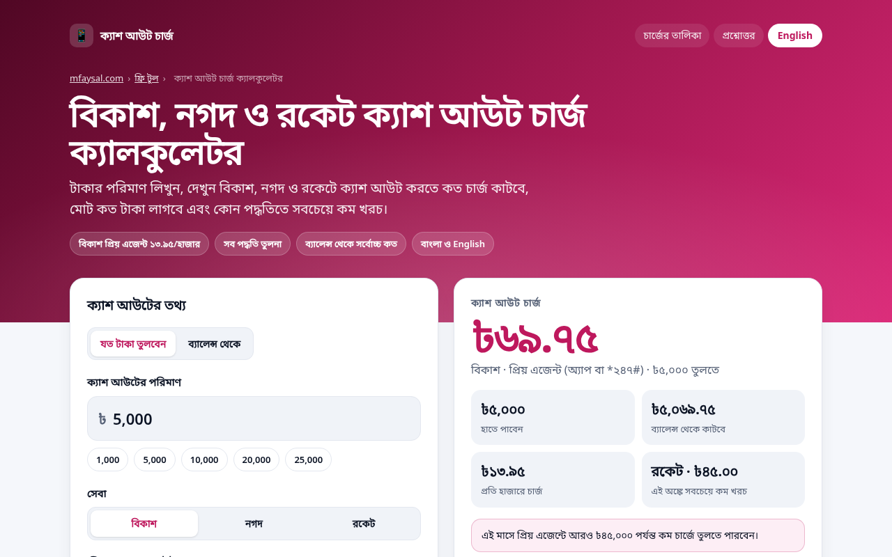

# bKash, Nagad & Rocket Cash Out Charge Calculator

**Live:** https://bkash-nagad-rocket-charge-calculator.vercel.app
**Project page:** https://mfaysal.com/projects/bkash-nagad-rocket-charge-calculator

A free, bilingual (**বাংলা** by default, English toggle) calculator for **mobile financial service cash out charges** in Bangladesh, comparing every bKash, Nagad and Rocket method for your amount.



## Features
- bKash: Priyo Agent Tk 13.95/1,000 (up to Tk 50,000 a month, with the over-limit rule), other agents Tk 18.50, ATM Tk 14.90
- Rocket: agent 1.67%, DBBL ATM and branch 0.9%; salary/stipend accounts agent 0.9%, ATM free, branch Tk 10
- Nagad: app Tk 12.99, *167# Tk 15, Islamic Tk 15 (marked unverified)
- Max cash out from a balance
- All methods compared, cheapest first
- Every rate editable; edits are kept in the share link
- Accessible (labels, keyboard, live regions), dark mode, no tracking, no cookies, no API keys
- SEO: canonical, Open Graph/Twitter card, `WebApplication` + `FAQPage` + `BreadcrumbList` JSON-LD, sitemap, robots.txt
- Bangla (`lang="bn-BD"`) by default with an English toggle; Bangla digits and lakh grouping (৳১২,০০,০০০)

## Tech
Plain HTML, CSS and JavaScript (ES modules), no build step and no dependencies. The calculation lives in [`public/charges.js`](public/charges.js) and is unit-tested (11 tests):

```bash
npm test   # node --test
```

| Test case | |
|---|---|
| bKash Priyo Agent: Tk 13.95 per 1,000 | ✅ |
| bKash official example: 49,500 used + 600 more = over the limit, Tk 18.50 per 1,000 | ✅ |
| bKash: exactly reaching Tk 50,000 still gets the Priyo rate | ✅ |
| bKash other agent Tk 18.50 and ATM Tk 14.90 per 1,000 | ✅ |
| Nagad app Tk 12.99, USSD Tk 15 per 1,000 | ✅ |
| Rocket general: agent 1.67%, DBBL ATM 0.9% | ✅ |
| Rocket salary account: agent 0.9%, ATM free, branch Tk 10 flat | ✅ |
| Total deducted = amount + charge | ✅ |
| Max cash out from a balance | ✅ |
| Comparison is sorted cheapest first | ✅ |
| Unknown method returns null | ✅ |

## Sources (checked 8 October 2026)
- [bKash: Cash Out (Priyo Agent, agent, ATM)](https://www.bkash.com/en/products-services/cashout)
- [Dutch-Bangla Bank: Rocket charges and fees](https://www.dutchbanglabank.com/rocket/charges-and-fees.html)
- [Nagad: not verifiable on nagad.com.bd (blocks automated checks); rates from published comparisons, editable](https://nagad.com.bd/)

> **Disclaimer:** rates as published on 8 October 2026; providers can change them at any time. Always confirm the charge in the app before you cash out. Not affiliated with bKash, Nagad or Rocket.

## Author
Built by **[Mahir Faysal](https://mfaysal.com)**, a web developer in Bangladesh making free tools in Bangla and English.
- Website and blog: [mfaysal.com](https://mfaysal.com)
- Need a website or web app? [Hire a web developer in Bangladesh](https://mfaysal.com/hire-web-developer-bangladesh)
- All free tools: [mfaysal.com/uk-tools](https://mfaysal.com/uk-tools)
- Also try the [Bangladesh Income Tax Calculator](https://bangladesh-income-tax-calculator.vercel.app) and [Electricity Bill Calculator](https://bangladesh-electricity-bill-calculator.vercel.app), plus the UK [Take-Home Pay Calculator](https://take-home-pay-calculator-uk.vercel.app), [Hourly to Salary Calculator](https://uk-hourly-salary-calculator.vercel.app), [Energy Running Cost Calculator](https://uk-energy-cost-calculator.vercel.app), [Redundancy Pay Calculator](https://uk-redundancy-pay-calculator.vercel.app) and [Holiday Entitlement Calculator](https://uk-holiday-entitlement-calculator.vercel.app)

MIT licensed.
